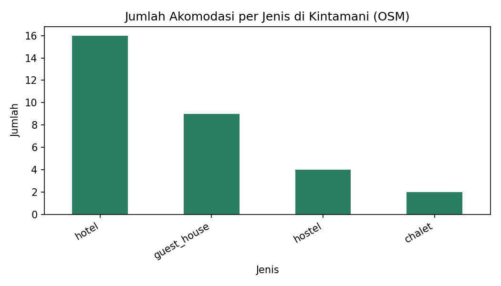

# Laporan Akuisisi Data Akomodasi di Kecamatan Kintamani

Mata Kuliah: BIFP-243 Akuisisi dan Manajemen Data | Nama: Ni Kadek Satya Giri Sardhula | NIM: 2501010088 | INSTIKI

Tanggal akses (UTC): 2026-11-11 09:01


## 1. Pendahuluan

Kecamatan Kintamani, Kabupaten Bangli, Bali, adalah kawasan wisata dengan Gunung dan Danau Batur sebagai daya tarik utama. Data resmi akomodasi biasanya tersedia dalam bentuk agregat dan terbit dengan jeda waktu. Laporan ini mendokumentasikan akuisisi data akomodasi dari OpenStreetMap (OSM) secara etis, terstruktur, dan dapat direproduksi.


## 2. Tujuan

- Mengambil data akomodasi Kecamatan Kintamani dari OpenStreetMap melalui Overpass API.
- Mengubah JSON hierarkis menjadi dataset tabular yang bersih.
- Menilai kualitas data dan membandingkan kelengkapannya dengan angka BPS.
- Mendokumentasikan provenance, kamus data, dan kepatuhan etika.


## 3. Sumber Data dan Etika

| Aspek | Penjelasan |
|---|---|
| Sumber | OpenStreetMap melalui Overpass API (overpass-api.de) |
| Lisensi | Open Data Commons Open Database License (ODbL) |
| Atribusi | © OpenStreetMap contributors |
| Pembanding | Kintamani Dalam Angka 2024 (isi nomor tabel/halaman di sini), tahun 2024 |

- Penghormatan API: User-Agent khusus dan retry exponential backoff (maksimum 4 percobaan).
- Minimisasi data: telepon, email, dan akun media sosial pemilik tidak diambil.
- Tidak ada scraping Traveloka, Booking.com, Agoda, Airbnb, atau Google Maps.
- Integritas data mentah: JSON disimpan utuh dan diberi hash SHA-256.
- Transparansi pembersihan: objek yang dibuang disimpan terpisah.


## 4. Metodologi


### 4.1 Query Overpass

Query mengambil node, way, dan relation bertag tourism berikut di area administratif Kintamani (admin_level=6): hotel, guest_house, hostel, motel, apartment, chalet, resort. Perintah out center tags memberi satu titik pusat untuk objek berbentuk poligon.

```
[out:json][timeout:90];
area["name"="Kintamani"]["boundary"="administrative"]["admin_level"="6"]->.kec;
nwr["tourism"~"^(hotel|guest_house|hostel|motel|apartment|chalet|resort)$"](area.kec);
out center tags;
```


### 4.2 Akuisisi dan Penanganan Galat

Fungsi ambil_overpass() mengulang permintaan saat timeout, galat koneksi, status HTTP selain 200, atau respons 200 kosong yang memuat remark dari server. Respons mentah disimpan dengan stempel waktu UTC.


### 4.3 Perataan dan Pembersihan

- Data diratakan menjadi tabel berkolom: osm_type, osm_id, nama, jenis, lat, lon, kecamatan, desa, jalan, bintang, jumlah_kamar, website, url_osm.
- Duplikat dideteksi dari kombinasi osm_type dan osm_id, lalu dibuang.
- Objek tanpa nama dipertahankan karena tetap valid sebagai akomodasi.
- Objek di luar bounding box (lintang -8.35 s.d. -8.12; bujur 115.28 s.d. 115.48) dibuang dan disimpan di akomodasi_di_luar_bbox.csv.


## 5. Hasil


### 5.1 Ringkasan Akuisisi

| Indikator | Nilai |
|---|---|
| Tanggal dan waktu akses (UTC) | 2026-11-11 09:01:42 |
| Total elemen dari Overpass | 32 |
| Duplikat | 0 |
| Objek tanpa nama | 1 |
| Objek di luar bounding box (dibuang) | 1 |
| Total baris dataset akhir | 31 |
| Hash SHA-256 data mentah | c6230dd7942d90e9577b40efb2be723e18962efc6dc08b7abc82e85b58872a58 |


### 5.2 Jumlah per Jenis Akomodasi

| Jenis | Jumlah | Persentase |
|---|---|---|
| hotel | 16 | 51.6% |
| guest_house | 9 | 29.0% |
| hostel | 4 | 12.9% |
| motel | 0 | 0.0% |
| apartment | 0 | 0.0% |
| chalet | 2 | 6.5% |
| resort | 0 | 0.0% |
| Total | 31 | 100% |




### 5.3 Perbandingan dengan Data BPS

Persentase kelengkapan = (jumlah OSM / jumlah BPS) x 100.

| Jumlah OSM | Jumlah BPS | Persentase | Tahun BPS |
|---|---|---|---|
| 31 | 205 | 15.12% | 2024 |

Data OSM baru mencakup 15.12% dari angka BPS (31 dari 205 objek), sehingga sebagian akomodasi diduga belum dipetakan di OSM atau tidak diberi tag tourism.


### 5.4 Kelengkapan Atribut

| Kolom | Persentase kosong |
|---|---|
| nama | 0.0% |
| desa | 100.0% |
| jalan | 96.8% |
| bintang | 96.8% |
| jumlah_kamar | 93.5% |
| website | 93.5% |


### 5.5 Verifikasi Manual

Sepuluh sampel acak bernama (random_state=42). Kolom hasil pengecekan diisi manual setelah membuka url_osm.

| No | Nama | Jenis | Desa | URL OSM | Hasil cek manual |
|---|---|---|---|---|---|
| 1 | Manik Tirta Cabin's | hotel | - | https://www.openstreetmap.org/node/11010451459 | (isi setelah dicek) |
| 2 | Caldera | hotel | - | https://www.openstreetmap.org/node/6451134585 | (isi setelah dicek) |
| 3 | Pondok Bali Cottage | guest_house | - | https://www.openstreetmap.org/node/9555392317 | (isi setelah dicek) |
| 4 | Segara Hotel | hotel | - | https://www.openstreetmap.org/node/7058054537 | (isi setelah dicek) |
| 5 | The Volcania Guesthouse | hotel | - | https://www.openstreetmap.org/node/5065920543 | (isi setelah dicek) |
| 6 | Entrance to: Bunbulan Hill Hostel | hostel | - | https://www.openstreetmap.org/node/5175562421 | (isi setelah dicek) |
| 7 | Batur Sunrise Guesthouse | hotel | - | https://www.openstreetmap.org/node/13068182153 | (isi setelah dicek) |
| 8 | Bunbulan Panorama Villas | guest_house | - | https://www.openstreetmap.org/node/9769685089 | (isi setelah dicek) |
| 9 | Hut | chalet | - | https://www.openstreetmap.org/node/5479746121 | (isi setelah dicek) |
| 10 | The Lakeview Hotel Bali | hotel | - | https://www.openstreetmap.org/node/1977779907 | (isi setelah dicek) |


## 6. Pembahasan

- Jenis terbanyak adalah hotel (16 objek).
- Data OSM baru mencakup 15.12% dari angka BPS (31 dari 205 objek), sehingga sebagian akomodasi diduga belum dipetakan di OSM atau tidak diberi tag tourism.
- Atribut paling sering kosong: desa (100.0%). Atribut opsional di OSM memang tidak selalu diisi kontributor.
- Bounding box berbentuk persegi sehingga objek di tepi wilayah dapat terpotong atau lolos secara keliru.


## 7. Keterbatasan

- Data OSM bersifat sukarela sehingga kelengkapannya tidak merata antar-desa.
- Akomodasi yang belum dipetakan atau tidak bertag tourism tidak terambil.
- Nama area di query bergantung pada penamaan di OSM.
- Verifikasi manual hanya mencakup 10 sampel.
- Data adalah potret pada waktu akses dan dapat berubah.


## 8. Kesimpulan

Akuisisi data akomodasi Kintamani dari OpenStreetMap berhasil diotomatisasi dengan penanganan galat, pemeriksaan kualitas, dan dokumentasi provenance. Dataset akhir berjumlah 31 objek dengan kelengkapan 15.12% terhadap data BPS. Data layak dipakai sebagai gambaran awal sebaran akomodasi, dengan catatan keterbatasan di atas.


## 9. Atribusi dan Daftar Pustaka

- OpenStreetMap contributors. Data di bawah lisensi ODbL. https://www.openstreetmap.org/copyright
- Overpass API. https://overpass-api.de
- Badan Pusat Statistik. Kintamani Dalam Angka 2024 (isi nomor tabel/halaman di sini).
